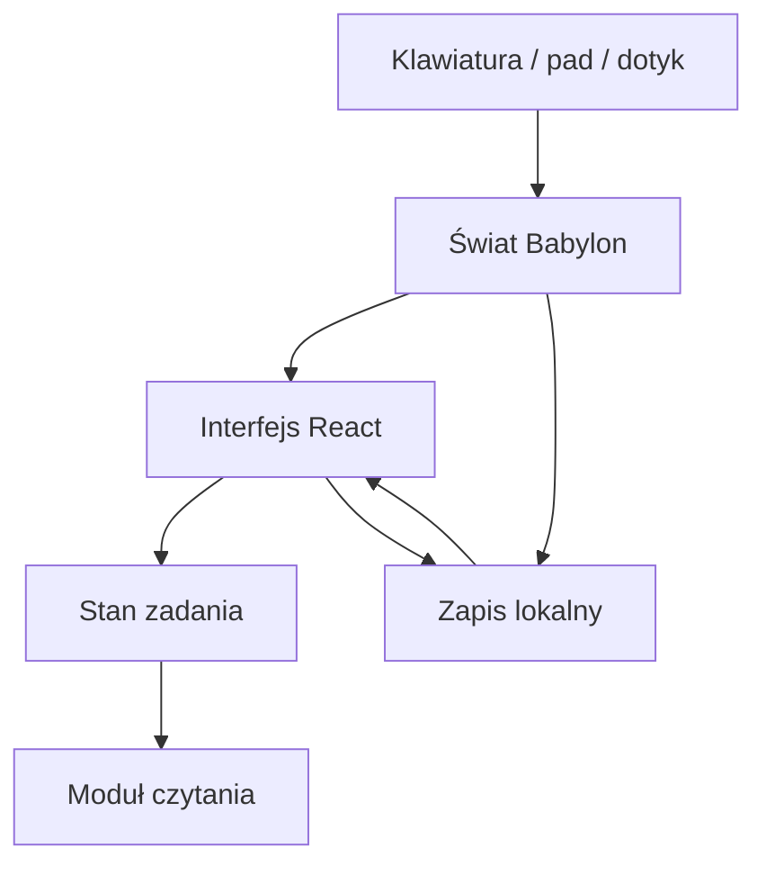

# Architektura P0

Gra jest niezależna od Leśnego Labiryntu. Jednostka świata odpowiada orientacyjnie metrowi. Oś Y oznacza wysokość, +Z jest kierunkiem startowego spaceru; Babylon używa domyślnego układu lewoskrętnego.

## Podział odpowiedzialności

| Moduł | Odpowiedzialność |
| --- | --- |
| `game/world.ts` | Budowanie sceny i tej samej listy przeszkód dla ruchu. Stała geometria scalona według materiału i udziału w kolizjach kamery. |
| `game/movement.ts` | Czyste funkcje: ruch względem kamery, limit obrotu, martwa strefa pada, wysokość terenu, kolizje. |
| `game/runtime.ts` | Pętla renderowania, delta czasu, postacie, podążająca kamera, raycasty, animacje i callbacki do UI. |
| `game/input.ts` | Klawiatura, Gamepad API, joystick; akcje pada są wykrywane na zboczu, bez wielokrotnego wyboru przez przytrzymanie. |
| `characters/models.ts` | Modele z brył Babylon i proste animacje proceduralne, bez importowanego rigu. |
| `reading/model.ts` | Ocena wyboru, historia prób i podpowiedzi. Bez importów Babylon, React lub przeglądarki. |
| `quests/model.ts` | Stan available → active → completed; ukończenie i nagroda są idempotentne. |
| `data/quests.ts` | Polski dialog, instrukcja, warianty odpowiedzi, podpowiedź i nagroda. |
| `persistence/` | Walidowany SaveState v1, kolejka zapisów, IndexedDB i fallback. |
| `ui/` | HUD i ręczne dialogi, focus trap, wybór sylaby, sterowanie dotykowe. |
| `audio/speech.ts` | Opcjonalna synteza mowy, bez mikrofonu. |

## Pętla ruchu i kamera

Strzałki mają osobne osie: lewo/prawo obracają postać z prędkością 144°/s, a góra/dół poruszają wzdłuż jej kierunku patrzenia; cofanie nie odwraca postaci. Przy równoczesnym użyciu urządzeń strzałki mają pierwszeństwo dla ruchu. WASD, pad i dotyk nadal obliczają ruch względem yaw kamery, normalizują przekątną i obracają model do wektora ruchu z limitem 540°/s. Docelowe prędkości: 2.4 i 4.0 jednostki/s. Rozpędzanie osiąga około 95% zadanej prędkości po 0.2 s. Delta klatki jest ograniczona do 50 ms, aby powrót z tła nie powodował teleportacji.

Kolizje ruchu: deterministyczna kapsuła w rzucie poziomym (koło) przeciw kołom i prostokątom; segment ruchu dzieli się na kroki ≤0.1 jednostki. Osobne osie pozwalają przesuwać się wzdłuż przeszkody. Pozycja Y pochodzi z tej samej funkcji wysokości co geometria terenu. Nie ma skoków ani fizyki brył w P0.

Kamera śledzi pozycję. Strzałki włączają podążanie za kierunkiem postaci: kamera otrzymuje ten sam przyrost obrotu, a pozostałe odchylenie po ręcznym rozglądaniu wygasza najkrótszą drogą, wykładniczo i niezależnie od liczby klatek. Wygaszanie kończy się również po puszczeniu strzałek. Przeciąganie kamery i prawy drążek mają pierwszeństwo; rozpoczęcie ruchu WASD/padem/dotykiem wyłącza podążanie, aby ruch względem kamery nie tworzył samonapędzającego się skrętu. Cztery raycasty przeciw oznaczonej geometrii zmniejszają dystans przed ścianą/drzewem. Przy bardzo małym dystansie model gracza jest chwilowo ukrywany, aby nie oglądać wnętrza głowy. Kamera i ruch są zatrzymane podczas czytania. To prototyp rozwiązania kolizji kamery; gęsty las wymaga odbioru wizualnego.

## Zadanie i zapis

Treści zadania są w `FIRST_QUEST`, kontrakt w `quest.schema.json`. Zła odpowiedź dopisuje próbę, bez utraty nagród i bez blokady ponowienia. Poprawna odpowiedź ustawia `reading.completed`, kończy zadanie i przyznaje boolowską, jednorazową nagrodę. Powtórka ćwiczenia dopisuje próby, ale nie zwiększa liczby nagród. Pełny system ekwipunku jest etapem P1.

SaveState v1 zawiera `player`, `camera`, `quest`, `welcomed`, `updatedAt`. Historia przechowuje ostatnie 200 prób. Wczytywanie sprawdza wersję, zakres pozycji, skończone liczby i spójność ukończenia. Niepoprawne dane nie trafiają do renderera. Kolejka zapisów zachowuje kolejność; odczyt nie uruchamia zapisu przed zakończeniem hydratacji.

Przy rozbudowie: dodać rejestr zadań po ID, migrację v1→v2 i kolekcję postępów, zachowując niezależność modułu czytania. Dodać modele glTF z animacjami przez adapter postaci, bez zmieniania logiki ćwiczeń.
